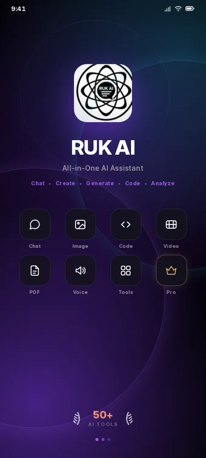
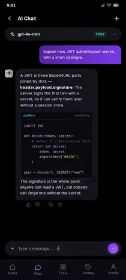
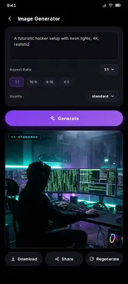
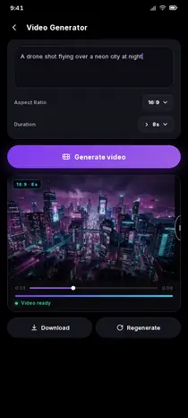
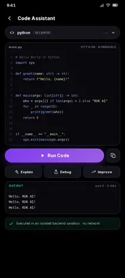
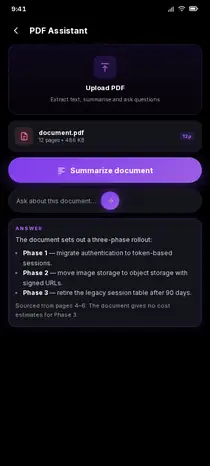

# RUK AI

**All-in-one AI assistant for Android** — chat, image and video generation, a code
assistant with a real execution sandbox, PDF question answering, a twelve-tool AI
library, and a FastAPI backend that keeps every provider key off the device.

This repository also ships an independent **Termux terminal agent** (`agent.py`),
covered in [Termux agent](#termux-agent). The two share a name and nothing else:
the terminal agent is a separate, single-file tool for coding on-device.

  
  
  
  
  

---

## Screenshots

Ten screens, rendered from the Compose sources in this repo — the strings, cards,
tabs and colours all come from the Kotlin that ships.

<table>
  <tr>
    <td align="center" width="20%">
       
      <b>Splash</b>
    </td>
    <td align="center" width="20%">
       
      <b>Dashboard</b>
    </td>
    <td align="center" width="20%">
       
      <b>AI Chat</b>
    </td>
    <td align="center" width="20%">
       
      <b>AI Tools</b>
    </td>
    <td align="center" width="20%">
       
      <b>Image Gen</b>
    </td>
  </tr>
  <tr>
    <td align="center">
       
      <b>Video Gen</b>
    </td>
    <td align="center">
       
      <b>Code Assistant</b>
    </td>
    <td align="center">
       
      <b>PDF Assistant</b>
    </td>
    <td align="center">
       
      <b>History</b>
    </td>
    <td align="center">
       
      <b>Profile</b>
    </td>
  </tr>
</table>

Each screen maps to one composable: `SplashScreen.kt`, `HomeScreen.kt`,
`ChatScreen.kt`, `ToolsScreen.kt` + `ToolLibrary.kt`, `ImageGeneratorScreen.kt`,
`VideoGeneratorScreen.kt`, `CodeAssistantScreen.kt`, `PdfAssistantScreen.kt`,
`HistoryScreen.kt`, `ProfileScreen.kt`.

**These are design mockups, not device captures.** A Compose project cannot be
screenshotted without an emulator, so each screen was rebuilt as a 412 dp HTML
layout using the exact strings and `RukColors` values from the Kotlin sources, then
rendered to WebP at 2x device scale. See
[`docs/screenshots/gallery.html`](docs/screenshots/gallery.html) for the full
gallery with per-screen notes. Where the reference design and the code disagree,
the code wins — e.g. the dashboard uses a two-column card grid because
`HomeScreen` calls `cards.chunked(2)`, and the profile shows its usage tiles as two
rows of two because that is what `ProfileScreen` composes.

---

## Table of contents

- [Screenshots](#screenshots)
- [What this is](#what-this-is)